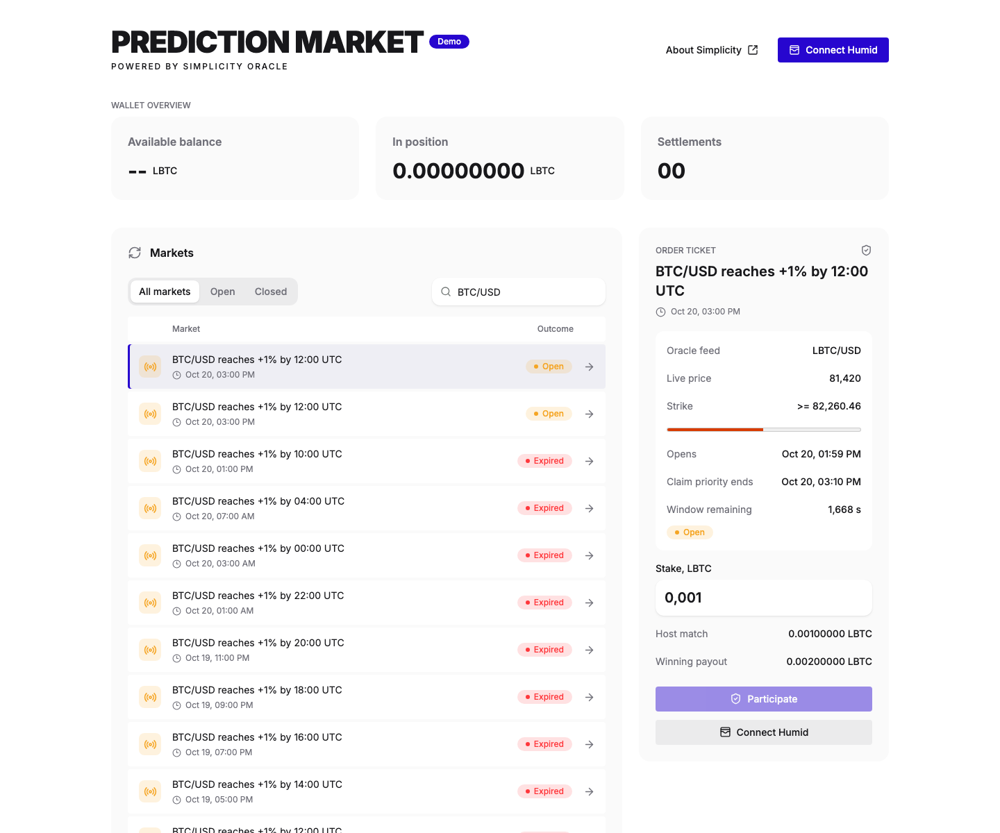

# Prediction Market

A Liquid Testnet prediction market demo built with Simplicity, Price Oracle, and the Humid wallet. Positions settle using signed price proofs and on-chain oracle vouchers, not admin-selected outcomes.



## Quick Start

Requires Docker Compose and the `price-oracle` repository alongside this one:

```text
workspace/
  prediction-demo/
  price-oracle/
```

From this repository, choose the Market desk admin credentials and start the stack. The server refuses to start without them; the password needs at least 16 characters. You can also put both variables in an untracked `.env` file.

```sh
export PREDICTION_ADMIN_LOGIN=admin
export PREDICTION_ADMIN_PASSWORD="$(openssl rand -base64 24)"
docker compose up --build -d --wait
```

Open the [web app](http://127.0.0.1:8080). The API runs at [http://127.0.0.1:3100](http://127.0.0.1:3100). Compose starts the frontend, API, and PostgreSQL using the official Liquid Testnet oracle. No local oracle stack is required.

Install Humid, select Liquid Testnet, and fund the wallet with testnet LBTC. The app provides an installation link when Humid is not detected.

## Market Flow

1. **Fund the host.** Open **Market desk** using the **Demo** button, sign in with your `PREDICTION_ADMIN_LOGIN` / `PREDICTION_ADMIN_PASSWORD`, and fund the address under **Escrow reserves**. Host deposits must be confirmed, unconfidential LBTC.
2. **Open a position.** Connect Humid, select a market, and participate. The host matches the stake 1:1; both contributions are locked in the contract.
3. **Claim a win.** When the price meets the target during the market window, request a price proof, then approve **Sign and claim** in Humid. A winning claim pays the full matched escrow, with fees funded separately.
4. **Sweep after expiry.** After the deadline and grace period, a manually published market's house Humid wallet can request an expiry Tick and sweep unclaimed escrow from **Market desk**.

Automatic BTC/USD markets publish once per twelve-hour UTC slot, with a randomly chosen +1% or -1% target and a 600-second claim grace period. Manual markets use the connected house Humid wallet's payout script.

Oracle requests cost **10,000 sats**, plus transaction fees. A sweep funds a separate Tick request; it does not reuse the position's prepaid price-request fee. Pending requests can be resumed without paying again.

## Configuration

Defaults are in [docker/server.toml](docker/server.toml). To customize them:

```sh
cp docker/server.toml docker/server.local.toml
PREDICTION_CONFIG=./docker/server.local.toml docker compose up -d --wait
```

- **Ports:** override `API_PORT` and `WEB_PORT`. Set `VITE_SERVER_API` before building for a different browser-accessible API URL.
- **Oracle trust:** the demo uses `trust_coordinator = true` to discover current assets and the oracle root. This trusts the configured coordinator; independent `[oracle_verification]` pins are also supported. Do not enable both modes.
- **Broadcasting:** Humid signs and broadcasts claims and sweeps through its own backend. Only the optional server relay needs Elements RPC for voucher burns.
- **Admin credentials:** pass `PREDICTION_ADMIN_LOGIN` and `PREDICTION_ADMIN_PASSWORD` when starting the server; config files must not contain them. After five failed sign-ins in a row, the server makes all sign-in attempts wait, doubling the delay up to five minutes; each failure is logged. Live e2e tests read the same values from `TEST_ADMIN_LOGIN` and `TEST_ADMIN_PASSWORD`.
- **Regtest:** use [server/config.example.toml](server/config.example.toml) with a separate database and the Price Oracle development stack. Never mix networks or their saved state.

## Development

Source builds require Bun, Rust 1.97.1, Simplex 0.1.1, and the compatible sibling Price Oracle checkout. Run `simplex install && simplex build` in both repositories' `contracts` directories first.

Create your local server config from [server/config.example.toml](server/config.example.toml). The example uses regtest: start the Price Oracle development stack and set `listen_address = "127.0.0.1:3100"` for the frontend's default API URL. Then start the server:

```sh
PREDICTION_ADMIN_LOGIN=admin PREDICTION_ADMIN_PASSWORD='<at least 16 characters>' cargo run -p prediction-demo-server
```

In a second terminal:

```sh
cd web
bun install
bun run dev
```

Run checks:

```sh
cargo test -p prediction-demo-server
cargo test -p prediction-demo-contracts --lib --test price_market
cd web
bun run test && bun run lint && bun run build
bunx playwright test e2e/price-ui.spec.ts
```

Live integration tests require a dedicated regtest stack and modify chain state. Do not run them against funded deployments.

## Safety

This is demo software, not production custody. Replace the default admin and database credentials before exposing it. The website never requests wallet private keys; the backend reserve wallet is a separate hot wallet.

Back up both the database and escrow signing key. `docker compose down` preserves their volumes; **`docker compose down -v` deletes them and can lose access to funded reserves**. Keep the original key when migrating deployments.

A sweep proves expiry, not that the target was never reached. Historical winning proofs can remain claimable after grace, but a claim and house sweep then compete for the same escrow. Settle promptly: oracle vouchers expire after roughly 60 blocks.

Only Tick-backed price markets are supported. Funded event or Verifier-only positions require the original software and signing key; upgrading does not rewrite or refund existing contracts. Storage is database-only, with no JSON import.
